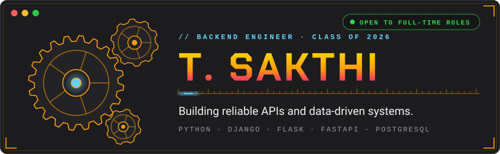
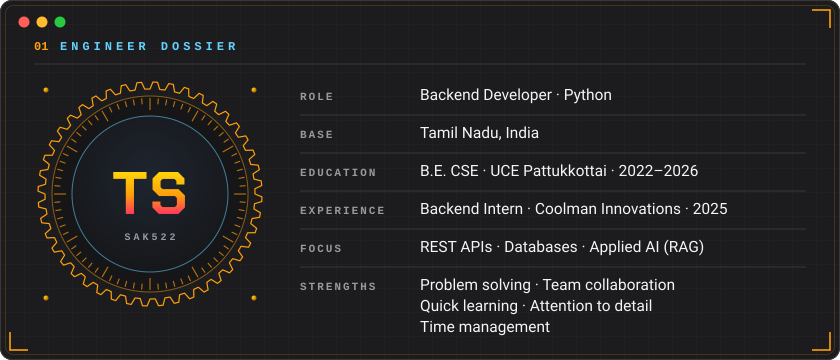
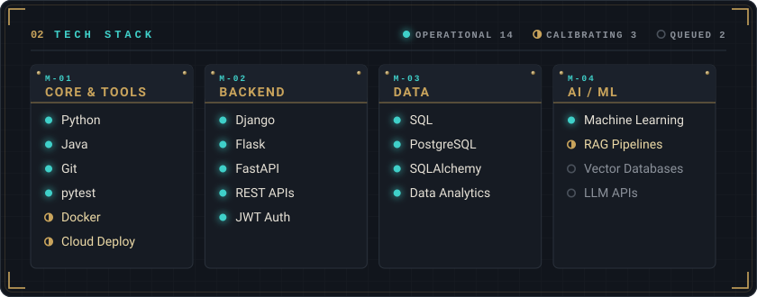
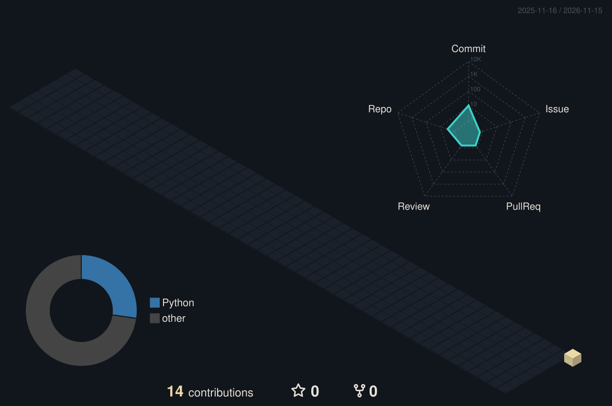

  
  
  

  

### `04` Featured Projects

| Project | What it does | Stack | Status |
|---|---|---|:-:|
| **[Expense Tracker REST API](https://github.com/SAK522/expense-tracker-api)** | Secured personal-finance API: JWT login, per-user data isolation, filters and monthly summaries | FastAPI · PostgreSQL · SQLAlchemy · pytest | **Shipped** |
| **Document Q&A API (RAG)** | Upload a PDF, ask questions in plain English, get answers with the source passage cited | FastAPI · embeddings · vector DB · LLM API | Up next |
| **Smart Agriculture Decision Support System** | B.E. project applying machine learning to support farming decisions | Python · machine learning | **Completed** |

### `05` Activity

  

3D contribution calendar · refreshed daily by GitHub Actions

