> [!TIP]
> **🎯 CURRENT OBJECTIVE:** Land a full-time **backend developer** role, building reliable APIs and data-driven systems.
> Recruiters and devs: [**press ▶ to join my party on LinkedIn**](https://www.linkedin.com/in/t-sakthi-2b312b357).

## 🗺️ Quest Log

| | Quest | Type | Loot earned | Status |
|:-:|---|---|---|:-:|
| 🟢 | **[Expense Tracker REST API](https://github.com/SAK522/expense-tracker-api)** Secured personal-finance API with per-user data isolation | Main quest | FastAPI · JWT · PostgreSQL · SQLAlchemy · pytest | ✅ Cleared |
| 🟡 | **Document Q&A API (RAG)** Upload a PDF, ask questions, get answers with cited sources | Main quest | Embeddings · Vector DB · LLM APIs | 🔜 Up next |
| 🟢 | **Backend Internship — Coolman Innovations** Built and tested REST APIs connected to databases | Guild quest | Django · Flask · REST APIs · Git | ✅ Cleared |
| 🟢 | **Smart Agriculture Decision Support System** Machine learning to support farming decisions | Academic quest | Python · Machine Learning | ✅ Cleared |

## 🌳 Skill Tree

### 🎒 Inventory

  

## 🏆 Achievements

## 🐍 Contribution Arena

  <picture>
    <source media="(prefers-color-scheme: dark)" srcset="https://raw.githubusercontent.com/SAK522/SAK522/output/github-snake-dark.svg" />
    <source media="(prefers-color-scheme: light)" srcset="https://raw.githubusercontent.com/SAK522/SAK522/output/github-snake.svg" />
    
  </picture>

## 🤝 Join My Party

  
  
  

