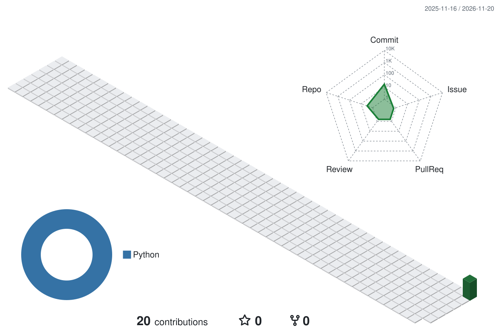

<picture>
  <source media="(prefers-color-scheme: dark)" srcset="assets/header-dark.svg" />
  <source media="(prefers-color-scheme: light)" srcset="assets/header-light.svg" />
  
</picture>

I'm a backend developer and 2026 Computer Science graduate. I design and build REST APIs in Python, covering authentication, relational data modelling and automated tests, and I'm looking for a full-time backend role.

**Currently:** deploying both APIs below with live demos, and deepening my work on retrieval-augmented generation (RAG).

### Featured work

**[Document Q&A API (RAG)](https://github.com/SAK522/document-qa-api)**  
Upload a PDF, ask questions in plain English, and get answers grounded in the document with page citations. It refuses when the document doesn't contain the answer, using a two-stage guard, and works with any OpenAI-compatible LLM. 60 automated tests.  
`FastAPI` `RAG` `PostgreSQL` `NumPy` `pytest`

**[Expense Tracker REST API](https://github.com/SAK522/expense-tracker-api)**  
A secured personal-finance API: JWT login, per-user data isolation, filtering by month, category and type, and period summaries computed in SQL. 10 endpoints, 25 automated tests.  
`FastAPI` `PostgreSQL` `SQLAlchemy` `pytest`

**Smart Agriculture Decision Support System**  
B.E. project applying machine learning to support decisions in agriculture.  
`Python` `Machine learning`

### Experience

**Backend Developer Intern** · Coolman Innovations · Jul – Aug 2025  
Developed and tested RESTful APIs with Django and Flask, connected them to relational databases, and worked in a Git-based team workflow.

### Skills

| Area | Skills |
|---|---|
| **Languages** | Python, Java, SQL |
| **Backend** | Django, Flask, FastAPI, REST API design, JWT authentication |
| **Data** | PostgreSQL, SQLAlchemy, data analysis |
| **Tooling** | Git, pytest, Docker (learning) |

### Activity

<picture>
  <source media="(prefers-color-scheme: dark)" srcset="profile-3d-contrib/profile-dark.svg" />
  <source media="(prefers-color-scheme: light)" srcset="profile-3d-contrib/profile-light.svg" />
  
</picture>

### Contact

Open to backend developer roles. The best way to reach me is [LinkedIn](https://www.linkedin.com/in/t-sakthi-2b312b357).
